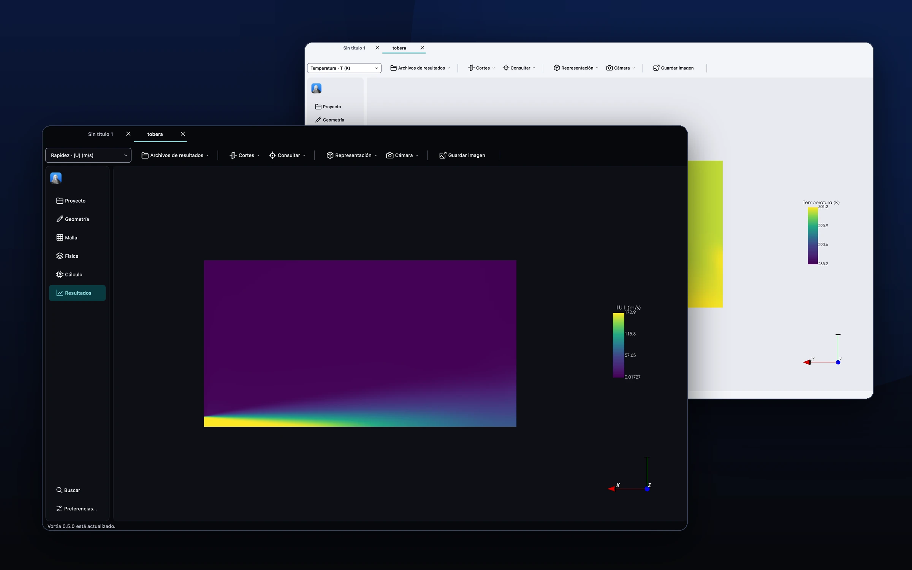
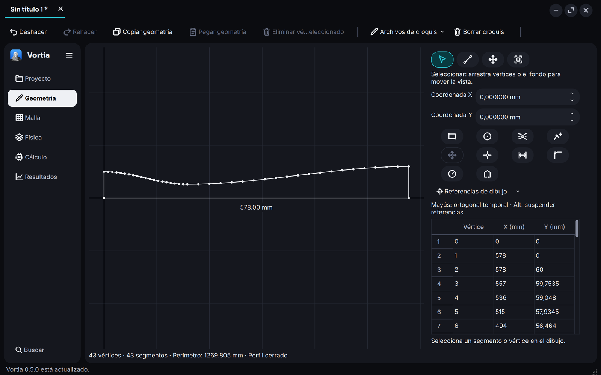
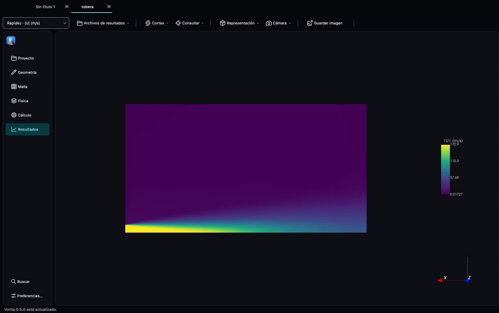
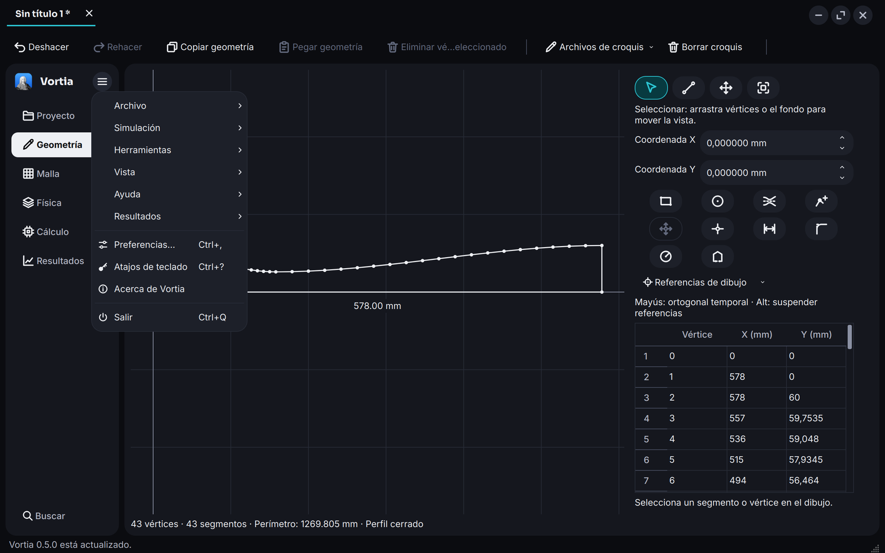
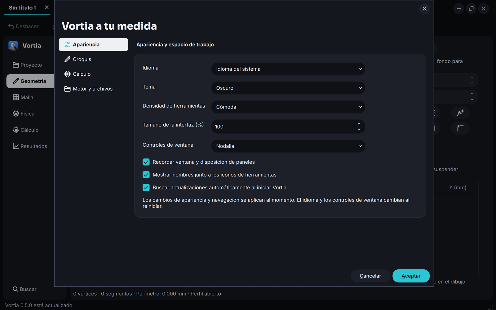

<div align="center">
  <a href="https://getnodalia.com">
    <picture>
      <source media="(prefers-color-scheme: dark)" srcset="https://raw.githubusercontent.com/danielmigueltejedor/nodalia-web/main/assets/brand/nodalia-wordmark-white.svg">
      
    </picture>
  </a>
  <br><br>
  
  <h1>Vortia</h1>
  <p><strong>A free desktop application for CFD simulation with OpenFOAM, from geometry to 3D post-processing.</strong></p>

  <p>
    
    
    
    
    
    <a href="./LICENSE"></a>
  </p>

  <p>
    <a href="#overview">Overview</a> ·
    <a href="#screenshots">Screenshots</a> ·
    <a href="#what-it-does">What it does</a> ·
    <a href="#installation">Installation</a> ·
    <a href="#verification">Verification</a> ·
    <a href="#building-from-source">Build</a> ·
    <a href="#project-status">Status</a> ·
    <a href="#documentation">Docs</a> ·
    <a href="#contributing">Contribute</a>
  </p>
</div>

<p align="center">
  
</p>

---

## Overview

**Vortia** is a native C++/Qt application that drives OpenFOAM through one
workflow: geometry → mesh → physics → supervised run → interactive 3D
post-processing, without touching the terminal. The published installers are
self-contained: OpenFOAM, MPI and the mesher ship inside them.

Vortia is a Nodalia app maintained by one person. Today it computes with
OpenFOAM; the direction is an application written entirely in Rust and a fluid
dynamics engine of its own, built from OpenFOAM ([`docs/ROADMAP.md`](docs/ROADMAP.md)).
It does not have parity with commercial CFD suites, and it says so: every
capability is listed with the evidence behind it in
[`docs/CAPABILITY_MATRIX.md`](docs/CAPABILITY_MATRIX.md).

> [!IMPORTANT]
> **Vortia is experimental.** Always check convergence, mass balance and mesh
> dependence, and read [`docs/KNOWN_LIMITATIONS.md`](docs/KNOWN_LIMITATIONS.md)
> and [`docs/VALIDATION.md`](docs/VALIDATION.md) before trusting a result. The
> native cases are numerical verification, not validation of a design.

## Screenshots

| | |
|---|---|
|  |  |
| Geometry: a nozzle drawn with the sketch's generator | Results: speed field of a jet |
|  |  |
| Main menu: Preferences, Keyboard Shortcuts, About | Preferences, with Nodalia or desktop window controls |

The results view shows the `examples/nozzle-practice-2026` case; the sketch is a
nozzle made with the sketch's generator. `geometry-light.webp` and
`results-speed-light.webp` are the same views in light mode. These are interface
captures, not validation: see [`docs/VALIDATION.md`](docs/VALIDATION.md).

## What it does

| Area | Vortia 0.5.0 | Evidence |
|---|---|---|
| Geometry | Rectangular domains, 2D sketches with dimensions, lines and arcs, axisymmetric wedges, STL import for viewing | Software tests |
| Meshing | Structured `blockMesh` with grading; Gmsh 2D and axisymmetric meshes from sketches; ASCII Fluent `.msh` import | Native runs |
| Incompressible laminar | Transient `icoFoam` and steady `simpleFoam` from the interface | Native: Poiseuille, Ghia cavity |
| RANS turbulence | Steady k-ω SST with wall functions | Native: flat plate against a correlation |
| Compressible | Experimental in-house solver for axisymmetric nozzles | No physical validation |
| Parallel | Local MPI, 1 to 8 processes, in the experimental compressible flow | Native self-test |
| Post-processing | Contours and profiles in the VTK viewer, section analysis, HTML/CSV/JSON reports | Software tests |
| Verification | Three-mesh GCI, flow-rate balance, profile comparison | Native and software |

Not available: LES/DES, heat transfer, multiphase, combustion, moving meshes,
general 3D geometry with automatic volume meshing, remote or HPC runs. The
full table, with what "evidence" means, is in the capability matrix.

## Installation

Installers are published on the [Releases page](https://github.com/danielmigueltejedor/vortia/releases).

| System | File | Requirements |
|---|---|---|
| macOS | `Vortia-<version>-macos-arm64.dmg` | Apple Silicon, macOS 14 or later. Ad-hoc signed and not notarised: the first time, right-click → Open |
| Linux | `Vortia-<version>-linux-x86_64.AppImage` | x86_64, glibc 2.31 or later (Ubuntu 20.04+, Debian 11+, Fedora, Arch…). Give it execute permission and open it |

You do not need to install OpenFOAM, MPI, Python or Gmsh: they are bundled.

On Linux the AppImage needs FUSE (`fusermount`), which common desktops
include; without it, run it with `--appimage-extract-and-run`. The
experimental compressible flow is not available in the Linux AppImage in
0.3.0, and on macOS it needs the Xcode Command Line Tools because its solver
is compiled on first use.

## Verification

Check an installation with the bundled engine:

```sh
vortia --verify-engine   # runs a real case in serial and with 2 processes
vortia --verify-mesher   # checks the bundled mesher
```

Registered native results for 0.3.0 are in [`docs/VALIDATION.md`](docs/VALIDATION.md):
Poiseuille 0.075 % (L2), Ghia cavity 0.35 %, and turbulent flat plate −10.2 %
against the correlation, inside the 15 % band fixed before the run. A case
that finishes is not a verified case: only those compared against their
reference within a tolerance set beforehand count.

## Building from source

**Stack:** C++20 · Qt 6 · VTK · OpenFOAM (external engine, through processes) · CMake · GoogleTest

| Tool | Minimum version | Notes |
|---|---|---|
| CMake | 3.24 | |
| C++20 compiler | Clang 15 / GCC 12 / MSVC 2022 | |
| Qt | 6.5 | Widgets, OpenGLWidgets |
| VTK | 9.2 | With the `GUISupportQt` module (Qt 6 build) |
| OpenFOAM | ESI v2412+ or Foundation 11+ | Only when building from source; the installers include it |

### macOS (Homebrew)

```sh
brew install cmake ninja qt vtk nlohmann-json hdf5 googletest
# Engine: OpenFOAM.app (gerlero/openfoam-app) or the one bundled in the published DMG.
```

### Ubuntu 24.04

```sh
sudo apt install cmake ninja-build qt6-base-dev libgl1-mesa-dev
# VTK 9 with Qt 6: apt (libvtk9-qt-dev) or your own build if the packaged one lacks GUISupportQt
# OpenFOAM ESI: https://develop.openfoam.com/Development/openfoam/-/wikis/precompiled
```

### Build and test

```sh
cmake -S . -B build -G Ninja -DCMAKE_BUILD_TYPE=Release
cmake --build build
ctest --test-dir build --output-on-failure
./build/bin/vortia
```

### macOS application bundle

```sh
cmake --build build-macos --target vortia_macos_bundle
open build-macos/Vortia.app
```

The development executable `build-macos/bin/vortia` remains available. For a
distributable package, `packaging/macos/deploy_bundle.py` bundles Qt and VTK
and applies an ad-hoc signature; the published DMG is built by the
`Release packages` workflow.

### Application icon

`resources/icons/vortia.png` (512 px) is embedded through the Qt resource
system (`:/vortia/app-icon.png`), so the window and the Dock use the same
design. It sits on the Nodalix app grid, like the Colloid icons around it: a
tile of 224/256 with a 16 px margin, a 51.5 px radius and a soft shadow, made
by `tools/nodalia-app-icon.py` in nodalix-icon-theme. `resources/icons/vortia-macos.png` is the same artwork at full bleed
for the macOS bundle, where the system applies its own icon mask.

The icon is a black-and-white portrait of Daniel Bernoulli over blue, part of
the Nodalia icon family. The source is an 18th-century engraving in the public
domain (Wikimedia Commons, `Daniel Bernoulli 001.jpg`).

## Parallel compressible runs

In Flow setup → Initialisation and calculation, **CPU processes** selects 1
to 8 processes (1 is serial). Changing it keeps the mesh and the saved
fields. Older projects stay on one process until the option is edited and
saved; new projects start from a value adapted to the machine, up to 8.

- The run uses MPI with Scotch inside `parallel-runs` and reconstructs only
  the last complete state when it finishes or is cancelled. Intermediate
  per-partition writes and logs stay in that folder for recovery, so include
  it in backups. If reconstruction fails, the last state of the main case is
  left intact.
- The solver revision bundled with the app is prepared in
  `solver-backends/<hash>`, with its own executable in `bin/<hash>`. The first
  run of a revision may compile it.
- Speed-up depends on the machine and the mesh; more processes can add
  communication cost. Courant steps were not increased and tolerances were
  not relaxed to obtain it.
- On the desktop, Open MPI processes yield the CPU while waiting for
  messages. An explicit `OMPI_MCA_mpi_yield_when_idle` in the captured
  environment is respected. Avoid running several calculations that together
  request more processes than the available cores.

The compressible flow remains experimental: check convergence, mass balance,
mesh dependence and sensitivity to the partition, especially in the
turbulent fields.

## Project status

Version **0.5.0**, experimental. What works, with which evidence, and what
does not:

- [`docs/CAPABILITY_MATRIX.md`](docs/CAPABILITY_MATRIX.md) — capabilities by area
- [`docs/KNOWN_LIMITATIONS.md`](docs/KNOWN_LIMITATIONS.md) — installers, engine and general restrictions
- [`docs/IMPLEMENTATION_STATUS.md`](docs/IMPLEMENTATION_STATUS.md) — implementation status
- [`docs/ROADMAP.md`](docs/ROADMAP.md) — what comes next
- [`CHANGELOG.md`](CHANGELOG.md) — changes by version

## Documentation

The project documentation is written in Spanish.

- Interface design (Nodalia Design Language): [`docs/DESIGN.md`](docs/DESIGN.md)
- Architecture and ADRs: [`docs/ARCHITECTURE.md`](docs/ARCHITECTURE.md)
- Technical research and licences: [`docs/architecture/research.md`](docs/architecture/research.md)
- Validation: [`docs/VALIDATION.md`](docs/VALIDATION.md)
- Fluent interoperability: [`docs/FLUENT_COMPATIBILITY.md`](docs/FLUENT_COMPATIBILITY.md)
- macOS setup: [`docs/MACOS_SETUP.md`](docs/MACOS_SETUP.md)

## Contributing

Issues and pull requests are welcome. [`CONTRIBUTING.md`](CONTRIBUTING.md)
sets the rules; the three that are not negotiable:

1. **No façades.** Every feature has real, tested behaviour or is explicitly labelled as not implemented.
2. **Scientific rigour.** No CFD capability is announced without verification or validation documented in `docs/VALIDATION.md`.
3. **No fictitious data** in flows presented as real. Test doubles live only in `tests/`.

## License

GPL-3.0-or-later. See [`LICENSE`](LICENSE); the dependency compatibility
review is in `docs/architecture/research.md` §8.

## Trademark notice

Vortia is an original brand and implementation, unrelated to ANSYS, Inc.
ANSYS and Fluent are trademarks of their respective owners. OpenFOAM is a
trademark of OpenCFD Ltd; Vortia is not approved or endorsed by OpenCFD.
