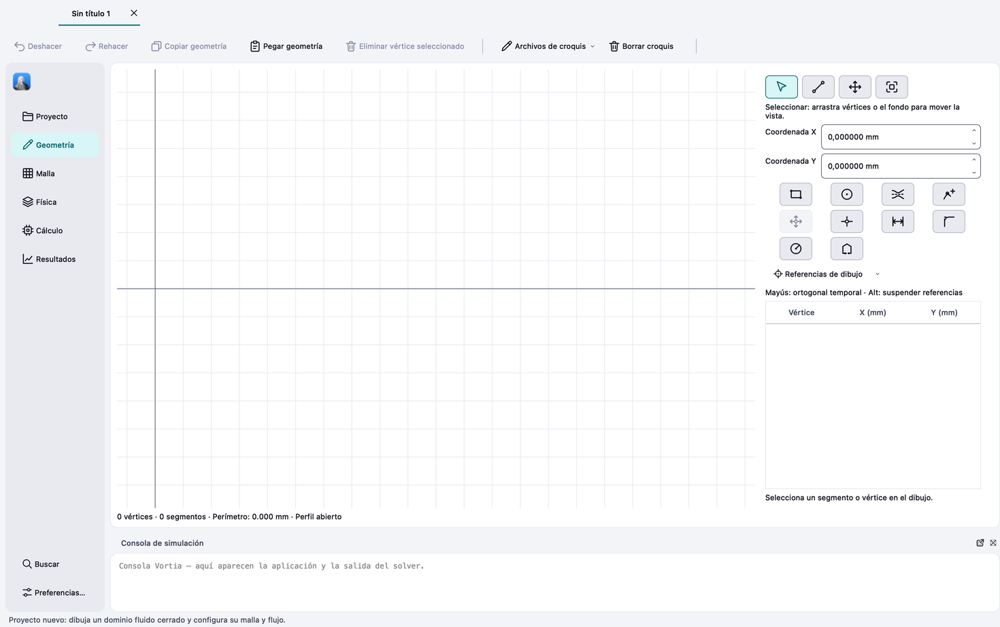
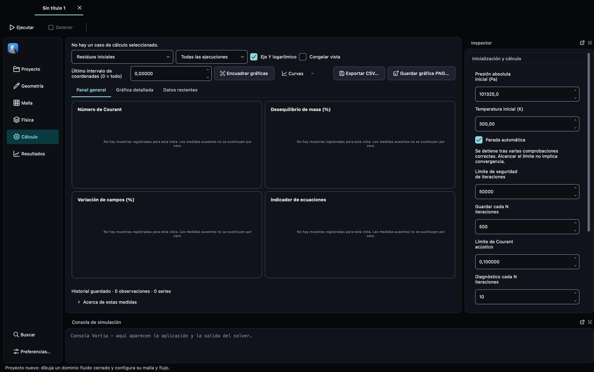

# Diseño de la interfaz

Desde la versión 0.5.0 Vortia usa el **Nodalia Design Language (NDL)**, el
lenguaje de diseño común de las aplicaciones de Nodalia, definido en el
repositorio [`nodalia-design`](https://github.com/danielmigueltejedor/nodalia-design).
Sustituye al estilo propio anterior («Lienzo · Papel»).

## De dónde sale cada cosa

| Archivo | Origen | Qué es |
|---|---|---|
| `resources/ndl/nodalia-qt.json` | Generado por `@nodalia/qtwidgets`; copiado sin cambios | Tokens: colores por modo, métricas por densidad, radios, espaciado, tipografía |
| `resources/ndl/nodalia.qss` | Generado por `@nodalia/qtwidgets`; copiado sin cambios | Hoja de estilos para los widgets estándar de Qt, con marcadores `{{grupo.nombre}}` |
| `resources/ndl/vortia.qss` | Propio de Vortia | Solo lo específico de Vortia: sus nombres de objeto y los iconos de los subcontroles |
| `vortia/ui/ThemeManager.hpp` | Propio de Vortia | Rellena los marcadores, construye la paleta de Qt y aplica el estilo |

Los dos primeros no se editan aquí. Para cambiar un color o una medida se
cambia el token en `nodalia-design`, se regenera y se vuelve a copiar; así el
cambio llega igual al resto de aplicaciones.

## Actualizar NDL

```sh
# en nodalia-design
npm run build -w @nodalia/tokens -w @nodalia/qtwidgets
cp packages/qtwidgets/dist/nodalia-qt.json packages/qtwidgets/dist/nodalia.qss <vortia>/resources/ndl/
```

Las pruebas `Ndl*` de `test_workspace` fallan si la hoja deja algún marcador
sin resolver en cualquier modo o densidad.

## Revisión visual

```sh
VORTIA_THEME=dark VORTIA_SCREENSHOT_STAGE=4 vortia --screenshot captura.png
VORTIA_DENSITY=compact vortia        # compact | regular | comfortable
```

`VORTIA_SCREENSHOT_STAGE` va de 0 (Proyecto) a 5 (Resultados).

## Límites conocidos

- Solo se ofrecen los modos claro y oscuro; los de alto contraste están en los
  tokens pero no hay preferencia para elegirlos.
- Preferencias ofrece densidad cómoda (la regular de NDL) y compacta; la cómoda de NDL (40 px) solo con `VORTIA_DENSITY`.
- Los campos numéricos quedan unos píxeles más altos que los desplegables: Qt
  añade altura propia a los `QSpinBox` con hoja de estilos.
- Qt no aplica el relleno de la hoja al texto de un `QSpinBox`; `ThemeManager`
  lo fija con márgenes de texto.
- Los iconos que nombra la hoja (flechas, cierre, marca de verificación) se
  copian teñidos a la caché del usuario al aplicar el tema, porque una hoja de
  estilos no puede cambiar el color de una imagen.
- Qt no deja fijar los márgenes de un `QToolBar` desde la hoja: los de la barra lateral se ponen en `MainWindow::applyPreferences` tras cada cambio de estilo.
- La barra superior con controles de ventana integrados (Linux) sigue en
  `vortia/ui/WindowChrome.hpp`.

## Capturas




