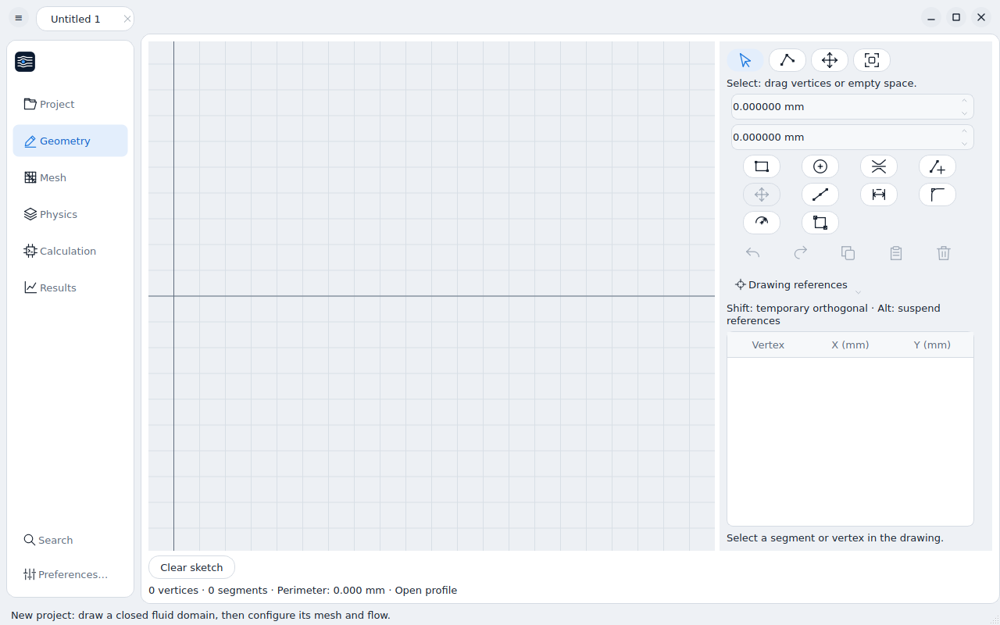
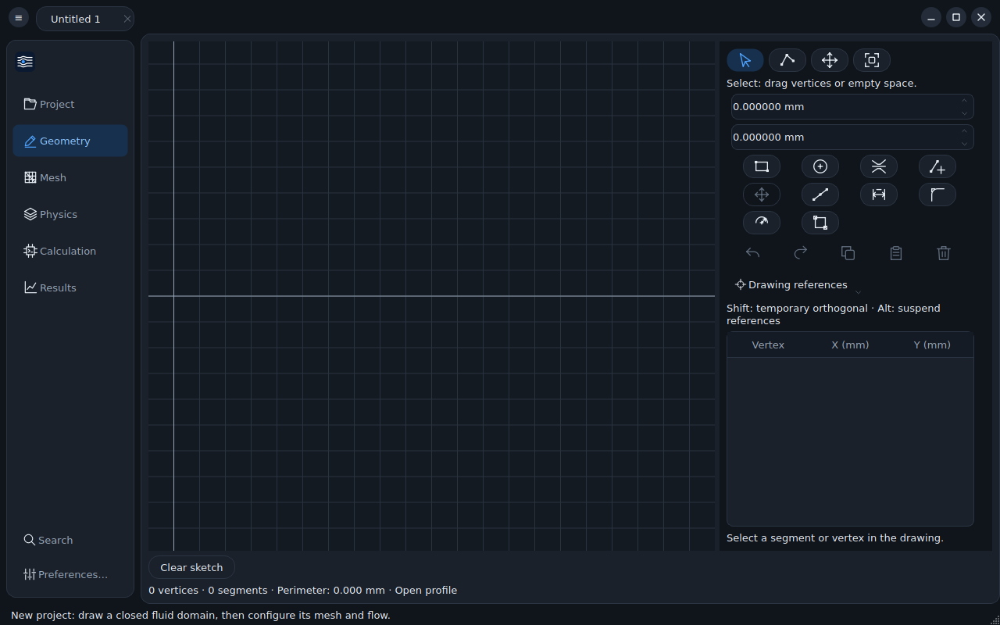

# Lienzo — lenguaje de diseño

Lienzo es el lenguaje visual de Vortia, pensado para reutilizarse en otras
aplicaciones de Nodalia. La variante actual es **Papel**: paneles blancos que
flotan sobre un lienzo gris claro, controles redondeados y un único color de
acento. Tiene esquema claro (el de referencia) y oscuro.





Capturas del CI (Ubuntu 24.04, AppImage): una sola barra superior con menú,
pestañas y controles de ventana.

## Qué se exporta

| Archivo | Para qué |
|---|---|
| `resources/lienzo/tokens.json` | Fuente única: colores por esquema, radios, espaciado, tamaños y tipografía |
| `resources/lienzo/lienzo.qss` | Hoja de estilos Qt con marcadores `{{grupo.token}}`; sirve para cualquier app Qt Widgets |
| `resources/lienzo/lienzo.css` | Variables CSS (`--lienzo-color-accent`…) para web o apps con vista web; generado |
| `vortia/ui/ThemeManager.hpp` | `lienzo::renderStyleSheet` rellena la plantilla con los tokens |
| `vortia/ui/WindowChrome.hpp` | Barra superior con controles de ventana integrados (Linux) |

Para llevar Lienzo a otra app Qt: copiar `tokens.json` y `lienzo.qss`, y
`ThemeManager` + `WindowChrome` (no dependen del resto de Vortia). Para una app
web: enlazar `lienzo.css`. Tras cambiar un token:

```sh
python3 tools/lienzo_export.py
```

`ctest` comprueba que el CSS exportado está al día y que todos los marcadores
de la plantilla se resuelven en ambos esquemas.

## Principios

1. **Una sola barra arriba.** Pestañas de documento, menú y controles de
   ventana comparten la barra superior. En macOS se conservan los botones
   nativos; en Linux los dibuja la app en esa misma barra, sin barra de título
   ni barra de menús adicionales.
2. **Tarjetas sobre lienzo.** El fondo de la ventana es `color.canvas`; la
   navegación, el área de trabajo y los paneles son tarjetas `color.surface`
   con borde `color.border` y radio `radius.panel`.
3. **Un único aspecto de «seleccionado».** Fondo `color.accentSoft` y texto
   `color.accentInk`, en navegación, pestañas, listas y botones conmutables.
4. **Un acento.** `color.accent` solo para la acción principal (botón por
   defecto), el foco y la selección. Nada más lleva color.
5. **Botones en píldora, campos redondeados.** Botones con `radius.pill`,
   campos con `radius.control` y fondo hundido (`color.surfaceSunken`).

## Tokens

- **Color** (`color.<esquema>.*`): `canvas`, `surface`, `surfaceSunken`,
  `border`, `borderStrong`, `ink`, `inkMuted`, `inkDisabled`, `hover`,
  `pressed`, `accent`, `accentHover`, `onAccent`, `accentSoft`, `accentInk`,
  `danger`, `success`, `warning`, `viewport`.
- **Radio**: `small` 5, `control` 8, `panel` 12, `pill` 14.
- **Espaciado**: `xs` 4, `sm` 8, `md` 12, `lg` 16, `xl` 24.
- **Tamaños**: `control` 28, `header` 44, `icon` 18.
- **Tipografía**: `base` 13, `small` 11, `title` 15, `mono` 12 (fuente del sistema).

Roles opcionales en Qt: `setProperty("lienzoRole", "primary")` o `"danger"`
en un `QPushButton`.

## Controles de ventana en Linux

`lienzo::systemButtonLayout()` decide lado y botones según el escritorio:

- familia GNOME: `gsettings get org.gnome.desktop.wm.preferences button-layout`
  (GNOME de serie solo muestra «cerrar», a la derecha);
- KDE: `ButtonsOnLeft` / `ButtonsOnRight` de `~/.config/kwinrc`;
- si no se puede saber: minimizar, maximizar y cerrar a la derecha.

Variables para pruebas o preferencias personales:

| Variable | Efecto |
|---|---|
| `VORTIA_WINDOW_BUTTONS="close,minimize,maximize:"` | Fuerza la disposición (sintaxis de GNOME) |
| `VORTIA_NATIVE_TITLEBAR=1` | Usa la barra de título del sistema |
| `VORTIA_FORCE_CSD=1` | Barra integrada también fuera de Linux (revisión de diseño) |
| `VORTIA_THEME=light\|dark` | Esquema para esta ejecución, sin cambiar la preferencia |

## Qué está probado

El CI ejecuta la AppImage con un gestor de ventanas real (openbox sobre Xvfb,
`packaging/linux/window_chrome_test.sh`) en Ubuntu 22.04 y 24.04 y comprueba
que la ventana no tiene marco del sistema, que se mueve al arrastrar la barra,
que se redimensiona desde un borde, que el doble clic maximiza y restaura, y
que el botón de cerrar cierra. Un test de la interfaz comprueba además que la
fila de herramientas mide lo mismo en todas las etapas y que la navegación no
cambia de posición.

## Límites conocidos

- Probado con X11 (openbox). En GNOME y KDE sobre Wayland se usan las mismas
  llamadas de Qt, pero no hay prueba automática; la lectura de la disposición
  de botones de GNOME/KDE solo está probada a nivel de analizador.
- La ventana sin marco en Linux no tiene esquinas redondeadas ni sombra propia;
  dependen del compositor.
- El visor 3D pinta su propio fondo; aún no lee `color.viewport`.
- `VORTIA_NATIVE_TITLEBAR=1` devuelve la barra de título del sistema.
